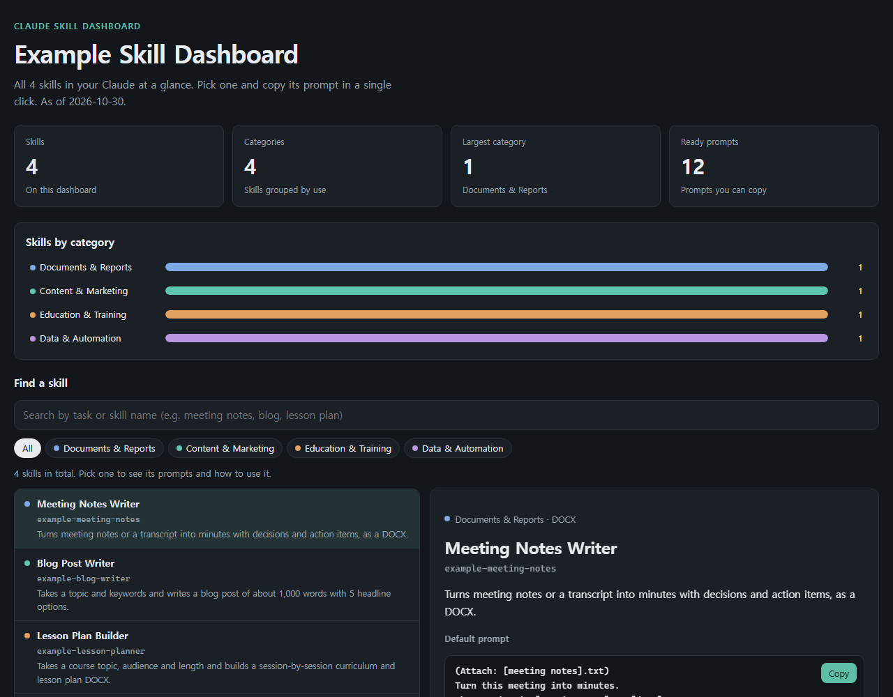

# Skill Dashboard Maker

[](LICENSE)


A Claude skill that reads every skill installed in your Claude and turns them into **one HTML skill dashboard**.

> Say "make my skill dashboard" and you get a page that lists each skill with a plain-language name, a one-line summary, its inputs and outputs, and **prompts you can copy and paste right away**.



<sub>Built from 4 made-up example skills. The file itself: [`examples/sample-skill-dashboard.html`](examples/sample-skill-dashboard.html)</sub>

## What it does

| Step | What happens | Result |
|---|---|---|
| 1. Collect | Scans your installed skill folders for names, descriptions and bundled files | Skill list |
| 2. Check for an update | If you attached a previous dashboard, picks out only the added, changed and removed skills | List of skills to rewrite |
| 3. Describe each skill | Reads each SKILL.md to the end and writes a name, summary, inputs and outputs, default and situational prompts, and tips | One entry per skill |
| 4. Build | Pours the entries into a design template and saves a single HTML file | `skill-dashboard.html` |

On the dashboard you can:

- Search and filter by **8 categories** (Documents & Reports / Content & Marketing / Education & Training / Books & Publishing / Planning & Analysis / Video & Design / Data & Automation / Other)
- **Copy** a default prompt and situational prompts for every skill
- Switch between light and dark mode, and use it on a phone
- Open it offline: it is one self-contained file
- Attach it later to **refresh only the skills that changed**, with added, changed and removed skills listed at the top

## Install

### A. Claude.ai (web and desktop app)

1. Download [`dist/skill-dashboard-maker.skill`](dist/skill-dashboard-maker.skill) (open the file and click **Download raw file**).
2. In claude.ai, open **Settings → Capabilities** and turn on **code execution and file creation**.
3. Go to **Customize → Skills → + Add → Upload a skill**, choose the `.skill` file and upload it. (Don't unzip it.)
4. You're done when skill-dashboard-maker appears in the list with its toggle on.

### B. Claude Code (plugin marketplace)

Inside Claude Code:

```text
/plugin marketplace add NogadaHunter/skill-dashboard-maker-en
/plugin install skill-dashboard-maker@peopleware-skill-dashboard-en
```

From a terminal:

```bash
claude plugin marketplace add NogadaHunter/skill-dashboard-maker-en
claude plugin install skill-dashboard-maker@peopleware-skill-dashboard-en
```

### C. Copy it yourself

Copy the whole [`plugins/skill-dashboard-maker/skills/skill-dashboard-maker/`](plugins/skill-dashboard-maker/skills/skill-dashboard-maker/) folder into `~/.claude/skills/`.

## Usage

| Situation | Say |
|---|---|
| First dashboard | `Make my skill dashboard` |
| With your name | `Make a skill dashboard under the name [your name]` |
| With your own title | `Make a skill dashboard called '[Marketing Team Skills]'` |
| Update | (attach your previous `skill-dashboard.html`) `Update my skill dashboard` |

Pick a skill on the dashboard, press **Copy** on a prompt and paste it into the chat. More prompts: [`docs/USAGE.md`](docs/USAGE.md)

> [!NOTE]
> The dashboard does not update itself. After you add, change or remove skills, attach the previous dashboard and say "update my skill dashboard".

### Other languages

The dashboard interface is in English. Skill entries are written in English by default; ask for another language (for example "write the entries in Spanish") and the names, summaries, prompts and tips are written in that language. A Korean edition is also available: [skill-dashboard-maker](https://github.com/NogadaHunter/skill-dashboard-maker).

## Where it looks for skills

| Environment | Location |
|---|---|
| Claude.ai | `/mnt/skills/user` (skills you uploaded) |
| Claude Code | `~/.claude/skills` (personal skills) |

To use skills somewhere else, tell Claude "my skills are in [path]". The dashboard maker leaves itself out of the list.

## Privacy

- The title only uses **a name you give**. The skill files contain no personal or company names.
- Instead of your skill folder path, the dashboard shows a generic label such as "claude.ai skills" or "Claude Code personal skills", so the account name on your computer never appears.

## Requirements

- Claude.ai: **code execution and file creation** turned on
- Claude Code: Python 3 (standard library only, nothing else to install)

## Repository layout

```text
skill-dashboard-maker-en/
├── .claude-plugin/marketplace.json        ← Claude Code marketplace listing
├── plugins/skill-dashboard-maker/
│   ├── .claude-plugin/plugin.json         ← plugin name and version
│   └── skills/skill-dashboard-maker/      ← the skill
│       ├── SKILL.md                       ← steps and rules
│       ├── scripts/                       ← collect_skills.py · build_dashboard.py
│       ├── assets/dashboard-template.html ← dashboard design
│       └── references/writing-guide.md    ← entry format, standards and categories
├── dist/skill-dashboard-maker.skill       ← for upload to Claude.ai
├── docs/                                  ← prompts, screenshot, publishing notes
├── examples/                              ← 4 made-up skills and an example dashboard
└── tools/                                 ← build_skill.py · check_repo.py
```

## Making changes

After editing the skill, rebuild `dist/` with `python tools/build_skill.py` and raise the `version` in `plugin.json`. History: [`CHANGELOG.md`](CHANGELOG.md)

## License

[MIT](LICENSE). Dashboards you make with this tool belong to you.

## Made by

Peopleware Education Consulting Group · AI Prompt Lab
